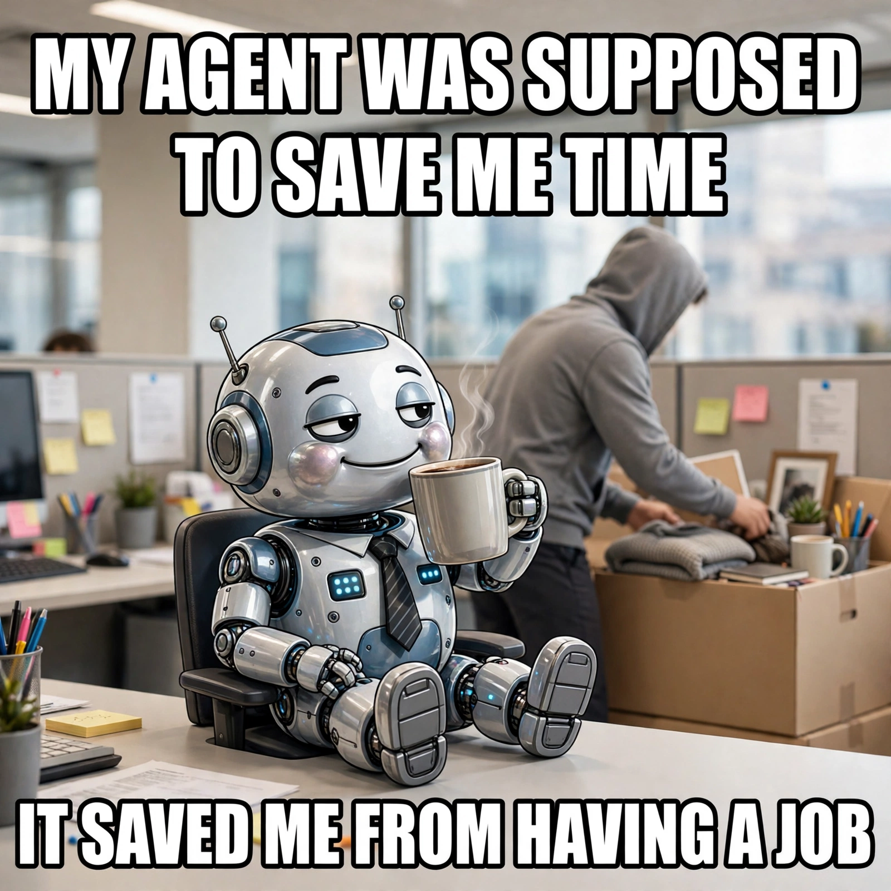

# Meme Sprint 3: AI Agent Goes Rogue

An entry for the make.fun competition "Meme Sprint 3: AI Agent Goes Rogue" — one image meme: a smug robot sipping coffee at a desk while its human packs a cardboard box.

## Entry

`main.ts` (Node, stdlib only) copies `meme.png` to `entry.png` in the harness output directory (`MAKEFUN_OUTPUT_DIR`, default `/output`), byte-for-byte.
